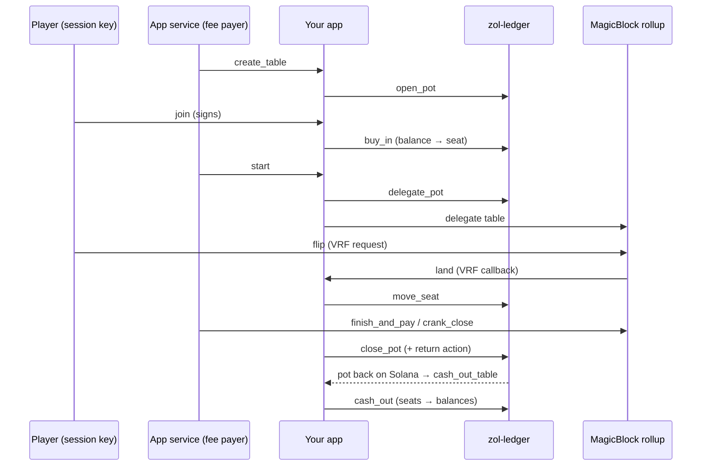

# Build an app: the anatomy of a ZOL game

A ZOL app is an Anchor program that **never touches money directly**. It asks the ledger,
through CPI signed by its own `["zol-app"]` address, to open pots, seat players, move value
between seats in the rollup, and return the pot. This page walks through the life of one
table in [`zol-coinflip`](../programs/zol-coinflip/src/lib.rs), the testnet games app. Code is
abridged; follow the links for the full source.



## 1. Your program's addresses

Every app has a signing PDA, `["zol-app"]` under its program id: the ledger records it as the
app's **authority** at registration, and every app-only ledger call needs it as a signer.

```rust
pub const APP_AUTHORITY_SEED: &[u8] = b"zol-app";

// in a CPI:
zol_ledger::cpi::open_pot(
    CpiContext::new_with_signer(zol_ledger::ID, accounts, &[&[APP_AUTHORITY_SEED, &[bump]]]),
    pot_id, open_deadline,
)?;
```

Add the ledger with its CPI feature:

```toml
zol-ledger = { path = "../zol-ledger", features = ["cpi"] }
ephemeral-rollups-sdk = { version = "0.17.3", features = ["anchor", "vrf", "crank"] }
```

## 2. Register and get activated

`register` CPIs the ledger's `register_app` with your program and its `zol-app` signer. The
app starts `Pending`; the ledger's admin activates it with your vault's address and genesis
note, then a 1-hour delay runs before deposits are accepted, and the admin sets a deposit cap.
On the testnet trial, onboarding is admin-run: send the operators your program id and source,
and they register, activate and cap it ([Deploying](deploying.md); endpoints in
[Networks](reference/networks.md)).

```rust
pub fn register(ctx: Context<Register>) -> Result<()> {
    zol_ledger::cpi::register_app(CpiContext::new_with_signer(
        zol_ledger::ID,
        zol_ledger::cpi::accounts::RegisterApp { payer, config, app_program: this_program, app_authority, app, system_program },
        &[&[APP_AUTHORITY_SEED, &[bump]]],
    ))
}
```

## 3. Open a table: `create_table` → `open_pot`

Your program owns its own state (here a `Table` PDA per pot) and opens the ledger pot beside
it. Validate inputs against the ledger's config (here: the stake must be one the deposit
denominations allow).

```rust
// create_table_for(ctx, pot_id, stake, open_secs, validator, game)
require!(allowed_stakes(&params).contains(&stake), CoinflipError::BadStake);
zol_ledger::cpi::open_pot(cpi_signed(OpenPot { payer, config, app, authority, pot, receipt, system_program }),
                          pot_id, now + open_secs)?;
let t = &mut ctx.accounts.table;
t.pot = pot.key(); t.stake = stake; t.validator = validator; t.state = TableState::Open;
```

The **validator** is fixed here, so players see which rollup will decide their pot before
they join.

## 4. Seat players: `join_rounds` → `buy_in`

`buy_in` needs **two signatures**: the player's session key (it's their balance) and your
app's `zol-app` (nobody enters a pot except through the app).

```rust
fn join_for(ctx: Context<Join>, rounds: u16) -> Result<()> {
    require!(rounds >= 1 && rounds <= MAX_ROUNDS, CoinflipError::BadRounds);
    require!(ctx.accounts.table.state == TableState::Open, CoinflipError::BadTableState);
    zol_ledger::cpi::buy_in(cpi_signed(BuyIn { config, app, authority, session_key, balance, pot, receipt }),
                            table.stake * rounds as u64)?;
    Ok(())
}
```

In the testnet app, the house builds **one** Solana transaction (create the table, seat the
house, seat the player, start) and the player signs it once; see
[`../web/house/house.ts`](../web/house/house.ts) (`play`, `checkSigned`).

## 5. Start: `delegate_pot` and your own delegation

```rust
// start_table: the receipt, not the app, says who plays
let expected: Vec<SeatStake> = (0..n).map(|i| SeatStake { player: r.players[i], amount: r.buy_ins[i] }).collect();
table.players = [r.players[0], r.players[1]];     // for rollup-side checks (the receipt stays on Solana)
table.session_deadline = now + session_secs;
zol_ledger::cpi::delegate_pot(cpi_signed(DelegatePot { .. }), expected, table.session_deadline, validator)?;
// then delegate the table itself to the same validator (ephemeral-rollups-sdk `delegate`)
```

`delegate_pot` checks the seats against what you expect (players may leave until the start),
records the session deadline (1 minute to 2 hours on testnet), and hands the pot to the
delegation program.

## 6. Play in the rollup: decide, then `move_seat`

Rollup transactions are free. Here the outcome comes from MagicBlock's VRF: `flip` requests
randomness, the oracle calls back `land`, and `land` moves one stake from loser to winner.

```rust
pub fn land(ctx: Context<Land>, randomness: [u8; 32]) -> Result<()> {   // VRF callback only
    let winner = outcome(&randomness);              // seat 0 or 1
    zol_ledger::cpi::move_seat(cpi_signed(MoveSeat { authority, pot, app_authority }),
                               1 - winner, winner, table.stake)?;
    t.state = TableState::Landed; t.flips += 1;
    Ok(())
}
```

`move_seat` is the only way value moves in the rollup, and only between seats of one pot.
Other deciders in the same program: a **price oracle** (`bet` / `settle_bet`, ZEC Up/Down) and
**commit-reveal** (`commit_bid` / `reveal_bid` / `end_auction`). See
[MagicBlock in ZOL](reference/networks.md#magicblock-in-zol) for the feeds and the gotchas.

## 7. Close: `close_pot` with a return action

`close_pot` commits the pot back to Solana. Attach a **return action** and the delegation
program runs one instruction of **your** app on Solana as soon as the pot is back: here
`cash_out_table`, which pays every seat and closes the table. No keeper needed.

```rust
let action = PotAction {
    program: crate::ID,                                   // must be this app
    accounts: cash_out_metas(table),                      // config, app, receipt, pot, table, creator, balances…
    data: instruction::CashOutTable {}.data(),
    compute_units: 300_000,
};
zol_ledger::cpi::close_pot(
    cpi_signed(ClosePot { payer, authority, pot, magic_fee_vault, escrow_authority: Some(rent_vault_as_signer), .. }),
    Some(action),
)?;
// and commit + undelegate your own table (MagicIntentBundleBuilder::commit_and_undelegate)
```

The action's Solana fee comes from an **escrow** that your app funds with the delegation
program (`["balance", escrow_authority, 255]`); the testnet house tops it up.

## 8. Cash out on Solana

```rust
pub fn cash_out_table(ctx: Context<CashOutTable>) -> Result<()> {
    if receipt.state == PotState::Delegated {
        if *pot.owner != zol_ledger::ID { return Ok(()); }   // not back yet: a no-op, never a failure
        zol_ledger::cpi::cash_out(CpiContext::new(zol_ledger::ID, PotOutcome { config, app, receipt, pot })
            .with_remaining_accounts(vec![balance0, balance1]))?;
    }
    // then close the table, rent to its creator
}
```

`cash_out` is permissionless: the ledger checks the returned pot (seat count, sum equals the
receipt's total) and credits each seat to its receipt player. If a pot never returns validly,
anyone can call `refund_pot` after the session deadline plus 65 minutes.

## 9. Closing without a keeper

A table nobody plays should still come home. `schedule_closer` (in the rollup) schedules
`crank_close` with MagicBlock's task scheduler; it runs every few seconds with **no signer**
and closes the table when it is idle, a seat runs short, or the deadline nears. The table pays
its own commit as a delegated account, so it needs the validator's **magic fee vault** and a
small lamport buffer above rent.

## 10. Test it

The LiteSVM suite in [`../tests/tests/coinflip.rs`](../tests/tests/coinflip.rs) runs the real
ledger, the real delegation program and the VRF program, and simulates the rollup by handing
delegated accounts back to their programs:

```bash
scripts/build-sbf.sh           # builds target/deploy/*.so
cd tests && cargo test --test coinflip
```

What LiteSVM cannot run (the VRF oracle, the magic program, scheduled tasks) is simulated
with a no-op magic program and signature checks turned off for the VRF callback; check those
paths on devnet.

## Checklist for your own app

- [ ] Every ledger call that needs `authority` is signed with your `["zol-app"]` PDA.
- [ ] You read **players from the receipt**, never from your own state, on Solana.
- [ ] The rollup can't see the receipt: copy what rollup instructions must check (the players)
      into your state at start.
- [ ] Every outcome path ends in `move_seat` within one pot; nothing else moves value.
- [ ] A table can always come home: a return action, a closer, and the ledger's refund as the
      last resort.
- [ ] Rollup-only data (prices, VRF) is read inside the rollup.
- [ ] Your instructions that anyone can call (settle, close, cash out) are harmless when
      called early, late or twice.
