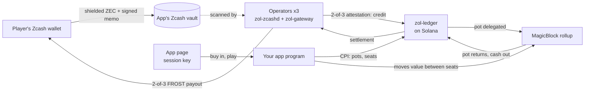

# Overview

ZOL lets an application accept shielded ZEC, run a real-time session, and pay the result back
to Zcash. The ZEC never leaves Zcash: it sits in a threshold-controlled vault while a ledger
program on Solana records who is owed what. Sessions run in MagicBlock ephemeral rollups, so
apps are ordinary Solana (Anchor) programs.

## What a player sees

1. **Deposit:** scan a payment link with any Zcash wallet and send shielded ZEC.
2. **Play:** the app's page signs with a key held by the player's passkey (or a saved session
   key). No Solana wallet, no SOL: fees are paid by the app or its operators.
3. **Withdraw:** the balance is paid back, shielded, to the Zcash address given at the first
   deposit.

## The moving parts

| Part | Role |
| --- | --- |
| **Vault** | One Zcash shielded address per app, its spend key split among the operators (FROST, 2 of 3). |
| **Operators** | Each runs `zol-zcashd` (scans the vault, builds and co-signs Zcash transactions) and `zol-gateway` (decides credits, attests them with a 2-of-3 Ed25519 key, relays to Solana, guards the ledger). |
| **`zol-ledger`** | One Solana program shared by every app: per-app balances keyed by players' session keys, pots, settlements. It never calls apps. |
| **Your app** | An Anchor program registered with the ledger. It opens pots, seats players, decides who wins, and asks the ledger to move value. It holds no ZEC and no player keys. |
| **MagicBlock rollup** | Where pots and app state live during a session: free, millisecond transactions, verifiable randomness (VRF), price feeds, scheduled tasks. |

## What ZOL guarantees, and what it doesn't

| Guarantee | Enforced by |
| --- | --- |
| Deposits are credited or voided, never both | One Solana account per deposit ID, written by a 2-of-3 attestation |
| An app cannot create value, add or swap a player, touch another app's money, or change a payout address | The ledger: apps only move value between seats of their own pots; payouts go to the receipt's players; payout addresses are fixed at first deposit |
| A player is never trapped | Unstarted pots can be left; a pot that never returns from the rollup is refunded after its deadline; exits are open to every balance |
| Payouts go only where the player said | The ledger stores a keyed commitment to the payout address; each operator checks a payout against it before signing |
| Nobody links a player's session key to their Zcash wallet | Deposits and payouts are shielded; Solana sees only session keys and commitments |

What you **trust**:

- **The operators** (2 of 3) for liveness and for not signing a false credit. They cannot move
  a balance or pay anyone the ledger didn't settle.
- **The rollup validator** for pot outcomes while a pot is delegated (it can reorder or
  withhold; withholding turns into a refund).
- **Your own app's logic** for who wins: the ledger checks that seats add up, not that the
  right seat won.

Details: [`../docs/design-v0.3.1.md`](../docs/design-v0.3.1.md) ("Trust model").

## What you can build

Anything with a **session**: players bring money in, interact in real time, and leave with a
result. On the testnet trial:

- **Coin flip** against the house: verifiable randomness, many flips per table.
- **ZEC Up/Down**: 30-second price bets settled on a live Pyth feed in the rollup.
- **Sealed-bid auction**: commit, reveal, first price, a certificate kept on Solana.

All three are one app program, [`../programs/zol-coinflip`](../programs/zol-coinflip/src/lib.rs),
with pages in [`../web/`](../web/). [Build an app](build-an-app.md) walks through it.

## Where to go next

- [Concepts](concepts.md) for the vocabulary.
- [Quickstart](quickstart.md) to deposit and play from code.
